 

---

### 🧙 Sobre mim

- ⚔️ Dev full-stack no time da **[GGSTORE](https://ggstore.dev.br/)**
- 🧩 Scripts em Lua pra FiveM: client/server, eventos e interfaces NUI
- 🌐 APIs REST em Node.js

### 🎒 Inventário

  

### 📜 Status do personagem

  

